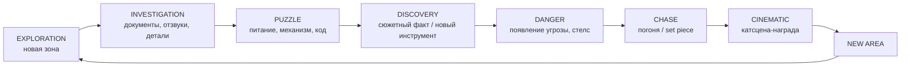

# VERITY: HOLLOW SUN — Game Design Document

> Статус: v0.1 (Phase 1). Рабочее название; кодовое имя проекта — `Verity`.
> Связанные документы: [Сюжет](02_Story.md) · [Персонажи и враги](03_Characters_and_Enemies.md) · [Локации](04_Locations.md) · [Gameplay systems](05_Gameplay_Systems.md) · [Техническая архитектура](06_Technical_Architecture.md) · [3D assets](07_Asset_List.md) · [Roadmap](08_Roadmap.md)

---

## 1. Название и логлайн

**VERITY: HOLLOW SUN** (рус. «VERITY: Полое Солнце»)

Альтернативы для обсуждения: *VERITY*, *The Long Noon*, *Solace Lightworks*.

**Логлайн.** Ноябрь 1999 года. Через несколько часов долину Грейуотер затопит новое водохранилище. Техник по спасению архивов Роуэн Вейл получает заказ: вынести из запечатанного комплекса *Solace Lightworks* загадочный «Реестр». Внутри Роуэна ждёт VERITY — жёлтая сфера, которая не умеет лгать и говорит детским голосом. Это голос самого Роуэна — из детства, которого Роуэн не помнит.

**Tagline:** *VERITY never lies. Do you?* («VERITY не умеет лгать. А ты?»)

## 2. Ключевые параметры

| Параметр | Значение |
|---|---|
| Жанр | First-person story-driven horror: исследование, головоломки, стелс, погони |
| Платформа | PC (Windows 10/11, DirectX 12), Steam. Геймпад и клавиатура/мышь |
| Движок | Unreal Engine 5 (C++ + Blueprints) |
| Длительность | 5 глав × 1.5–2.5 ч ≈ 9–11 ч первого прохождения. Плюс секреты и 3 концовки |
| Рейтинг | 16+ (психологический хоррор; насилие намёками, без расчленёнки) |
| Аудитория | Поклонники сюжетных хорроров 16–35 лет, любители лора, теорий и головоломок |
| Языки | Английский (основной: озвучка и текст) + полная русская локализация на старте |
| Монетизация | Премиум. Главы выходят эпизодами или одним релизом — решение в Phase 12 |

## 3. Видение

Игрок исследует огромный заброшенный комплекс, построенный вокруг одной идеи: **свет может хранить правду и может её стирать.** Каждый новый уровень комплекса — новая эпоха и новая ложь компании. Игрок собирает правду сам: по документам, записям, «отзвукам» памяти и деталям интерьера. VERITY — проводник, загадка и угроза одновременно. К финалу игрок должен решить, что важнее: правда, которая ранит, или утешение, которое лжёт.

## 4. Design Pillars (столпы)

1. **Свет — инструмент и угроза.** Главный инструмент игрока — фонарь с линзами. Каждая глава меняет отношения со светом. В Главе 1 свет выдаёт тебя Фонарщику, в Главе 3 свет защищает от Просоленных, в Главе 4 свет SOLACE стирает память. Игрок постоянно решает, включать ли свет.
2. **Каждая комната — свидетель.** Пустых помещений нет. В каждой комнате есть функция, история и как минимум одна деталь, которая отвечает на вопрос или задаёт новый.
3. **Страх ожидания, а не скримеры.** Напряжение строится на тишине, звуке, силуэтах и паузах. Полноценных jumpscares — не больше 2–3 за главу, и каждый заработан нарастанием (см. §9).
4. **Правду собирает игрок.** Игра никогда не выдаёт ответ целиком. Факты противоречат друг другу, источники ненадёжны (включая журнал самого игрока). Теории — часть геймплея.
5. **Ремесленное качество.** Каждый ассет, звук и строка текста выглядят сделанными вручную под этот мир. Никаких шаблонных решений и очевидных placeholder-ов в релизе.

## 5. Gameplay loop

### 5.1 Макро-цикл главы



В главе этот цикл проходит 3–4 раза в нарастающем масштабе. Последний цикл — кульминация главы и cliffhanger.

### 5.2 Микро-цикл (30 секунд – 3 минуты)

Заметить деталь → подойти → осмотреть или взять → получить информацию или предмет → новое микрорешение: куда идти, тратить ли батарею, рискнуть ли шумом.

### 5.3 Ресурсное напряжение

Ресурсов мало, но они не «выживательные». Это **батареи фонаря**, **сигнальные шашки** и **заряды стробоскопа**. Ресурс должен заставлять думать, а не собирать мусор. Аптечек нет: здоровье — это «одно-два касания до смерти», чтобы враги оставались страшными.

## 6. Игрок

- **Роуэн Вейл** (Rowan Vale), 22 года, техник фирмы *Hartwell Salvage & Records*. Пол персонажа не указан: вид от первого лица, видны только руки в перчатках.
- Роуэн **не говорит вслух**. «Голос» Роуэна — **полевой журнал**: короткие рукописные заметки, которые появляются после ключевых открытий. Журнал — часть сюжета: в Главе 4 его начинают переписывать.
- Чего Роуэн не знает (и не знает игрок): детство до 9 лет стёрто. Об этом см. [Сюжет](02_Story.md).

### 6.1 Управление (по умолчанию)

| Действие | KB/M | Геймпад |
|---|---|---|
| Движение / камера | WASD / мышь | LS / RS |
| Бег (выносливость) | Shift | LS click |
| Присед | Ctrl / C (toggle) | B |
| Выглянуть из-за угла | Q / E | LB/RB (удерживать + LS) |
| Взаимодействие | ЛКМ / F | X |
| Фонарь вкл/выкл | ПКМ | RT |
| Смена линзы | колесо / 1–5 | D-pad ◄ ► |
| Диктофон: запись / воспроизведение | R / T | D-pad ▲ / ▼ |
| Задержать дыхание | Alt (удерживать) | LT (удерживать) |
| Инвентарь / журнал | Tab / J | View / Menu |
| Пауза | Esc | Start |

Всё переназначается (Enhanced Input). Есть toggle-альтернативы для всех «удерживаемых» действий.

## 7. Обзор механик

Подробные спецификации — в [05_Gameplay_Systems.md](05_Gameplay_Systems.md).

| Механика | Суть | Глава |
|---|---|---|
| **Сигнальный фонарь Solace (Survey Lantern)** | Главный инструмент. Батарея, 5 сменных линз | 1 |
| Белая линза | Обычный свет. Выдаёт игрока светочувствительным врагам | 1 |
| Янтарная линза | Проявляет «светочернила» — скрытые надписи сотрудников | 2 |
| Линза Памяти (Recall) | Осколок тихостекла от VERITY. Показывает **Отзвуки** (световые слепки памяти) | 3 |
| Сигнальная линза (Strobe) | Стробоскоп: световые коды для механизмов, оглушение SOLACE | 4 |
| Призма | Объединяет линзы, расщепляет и перенаправляет луч | 5 |
| **Полевой диктофон** | Записывает звуки и голоса, воспроизводит их: отвлечение, голосовые замки | 2 |
| Электросеть | Предохранители, рубильники, маршрутизация ограниченной мощности | 1 |
| Безопасность | Камеры, мониторы, уровни допуска, жалюзи, тревоги | 2 |
| Стелс и шум | Поверхности, скорость, укрытия, задержка дыхания | 1–2 |
| **Ясность (Clarity)** | Восприятие игрока: искажения от Отзвуков и света SOLACE | 3 |
| **Забвение (Forgetting)** | Свет SOLACE стирает цели, метки, страницы журнала, названия предметов | 4 |
| Физические взаимодействия | Двери «рукой», вентили, рычаги, ящики, броски предметов | 1 |
| Рельсовая сеть | Вагонетки и стрелки (головоломки и перемещение) | 3 |
| Нарастающая вода | Таймерное давление в финале | 5 |

## 8. Прогрессия

- **Инструменты:** линзы (5), диктофон, ключи-допуски (уровни Amber → Teal → Red → White).
- **Знание как прогрессия:** многие замки открывает не предмет, а *знание* — код из документа, голос с плёнки, порядок событий из Отзвуков.
- **Табельные часы (Punch Clocks)** — диегетические точки ручного сохранения: Роуэн пробивает старую табельную карточку. Автосохранение — на чекпоинтах.

## 9. Хоррор-дизайн

### 9.1 Кривая напряжения главы

```
напряжение
  ▲                                              ╭─╮ кульминация
  │                     ╭──╮        ╭───╮       ╭╯ │
  │          ╭─╮       ╭╯  ╰╮      ╭╯   ╰╮    ╭╯  │╲ cliffhanger
  │    ╭─╮  ╭╯ ╰─╮  ╭─╯    ╰──╮╭─╯     ╰─╮╭─╯   │ ╲
  │ ╭─╯  ╰─╯     ╰──╯         ╰╯         ╰╯       │  ╲
  └────────────────────────────────────────────────────────► время
   тишина  первый  передышка  угроза  передышка  погоня
          признак  (safe room)          (катсцена)
```

### 9.2 Правила страха

1. **Бюджет скримеров:** не больше 2–3 полноценных jumpscares за главу. Между ними — минимум 15 минут. Контролирует `Scare Director` (см. Systems).
2. **Ложные тревоги дешевле настоящих.** Звук за стеной, упавший предмет, повернувшаяся пустая оболочка VERITY. Таких «микро-событий» много, но каждое мотивировано миром.
3. **Сначала силуэт.** Каждого врага игрок видит издалека или частично до первой встречи вплотную.
4. **Тишина — инструмент.** У каждой главы есть хотя бы одна зона почти полной тишины (Слушающие комнаты, соляные залы).
5. **Safe rooms.** Комнаты с табельными часами безопасны всегда. Игроку нужно где-то выдохнуть.
6. **Смерть — не наказание временем.** Чекпоинты частые; после смерти игрок возвращается за 30–90 секунд до неё.
7. **ИИ не читерит.** Враг знает только то, что увидел, услышал или получил через видимую игроку механику (см. AI в [03](03_Characters_and_Enemies.md)).

### 9.3 Уровни сложности

| | Story | Standard | Harrowing |
|---|---|---|---|
| Восприятие врагов | −30% | базовое | +25%, слышат дыхание вблизи |
| Расход батареи | −50% | базовый | +25% |
| Ручные сохранения | везде + часы | только часы | часы, 1 использование на часы |
| Подсказки головоломок | 3 уровня | 2 уровня | нет |
| Забвение (Глава 4) | смягчённое | полное | полное + 1 стираемый ключевой факт |

## 10. Нарративная подача

Без экспозиционных монологов. Инструменты подачи:

- **Документы** (~150): служебные записки, анкеты, каталоги, детские рисунки, протоколы.
- **Аудиодневники** на катушках и кассетах (~45), в том числе 10 плёнок Марты Вейл.
- **Видеозаписи** (~12): кинопроекторы 16 мм и мониторы ч/б наблюдения.
- **Отзвуки (Echoes)** (~40): световые слепки памяти, видимые через линзу Памяти.
- **Радио:** Десмонд Колдер ведёт Роуэна по рации. Это надёжный, а потом всё более подозрительный голос.
- **Environmental storytelling:** отметки роста на дверном косяке, табельные карточки, пустые места на фото.
- **Полевой журнал Роуэна:** выводы игрока «от первого лица».

Подробно — в [02_Story.md](02_Story.md).

## 11. UI/UX-принципы

- **Минимализм и диегетика.** Заряд батареи — стрелочный индикатор на корпусе фонаря. Инвентарь — раскрытая брезентовая сумка. Документы — физическая бумага крупным планом. HUD по умолчанию почти пуст.
- **Визуальный язык UI:** типографика и формы промышленной маркировки Solace 1930–80-х: трафарет, табельные карточки, латунные бирки. Цвет — тёплый янтарь на почти чёрном.
- Подсказки взаимодействия контекстные и мягкие: маленькая метка у объекта, без крупных иконок.
- Субтитры с именем говорящего и цветом спикера. Отдельная настройка для звуковых субтитров («[скрип металла слева]»).
- Меню: пауза, настройки (графика, звук, управление, доступность), сохранение/загрузка (карточки табельных часов), журнал, выбор главы после прохождения.

## 12. Визуальное направление

- **Жёлтый — якорь.** Насыщенный тёплый жёлтый (*Solace Yellow*) почти нигде больше не встречается. Где жёлтый — там VERITY или её след. Это работает в темноте и при красном аварийном освещении.
- Свет почти всегда **мотивирован**: лампы, окна, аварийные огни, фонарь игрока. Тьма — настоящая, но читаемая (контровой свет, силуэты).
- Палитры глав:

| Глава | Палитра | Свет |
|---|---|---|
| 1. Ламповые цеха | ржавчина, сажа, промышленный зелёный, латунь | натриевый янтарь, лучи из пилообразных фонарей |
| 2. Слушающие комнаты | бетон, бирюза, бежевый, оранжевые акценты 70-х | холодная люминесценция, мониторы |
| 3. Подземелье | бело-розовая соль, кристаллы, чёрная вода | фонарь игрока, свечение жил тихостекла |
| 4. Аннекс | стерильный белый, пастель, бледно-голубой | ровный «больничный» свет, красная тревога |
| 5. Полое Солнце | золото, латунь, отполированный камень | солнечный луч из шахты, ослепительный финал |

## 13. Аудио-направление

- Звук — 50% хоррора. Каждая зона имеет **слой эмбиента** (машины, вентиляция, капли, электрический гул) и **звуковой «отпечаток» врага**: свист Фонарщика, шорох рупоров Слушателя, хор прототипов, колыбельная SOLACE.
- **Музыка редкая.** Адаптивные слои включаются по уровню угрозы (calm → unease → threat → chase). В обычном исследовании музыки почти нет.
- **Мотив VERITY** — простая мелодия рекламного джингла Solace 70-х («A little sun in every home»). Она возвращается в искажённых вариантах: колыбельная, хор, финал.
- Подробно — в [05_Gameplay_Systems.md](05_Gameplay_Systems.md) §Audio.

## 14. Доступность

Ремап всех клавиш, toggle вместо удержания, размер и фон субтитров, звуковые субтитры, отключаемое покачивание камеры и motion blur, слайдер FOV (70–110), режим высокой контрастности интерактивных объектов, отключение мерцающих стробоскопов (заменяются на нестробящий эффект), пропуск катсцен после первого просмотра. Головоломки с цветом всегда дублируются формой или символом.

## 15. Объём контента (цели)

| Элемент | Количество |
|---|---|
| Главы | 5 |
| Уникальных зон | ~32 |
| Больших головоломок | 5 (по одной на главу) + ~25 малых |
| Типов врагов и угроз | 9 (см. [03](03_Characters_and_Enemies.md)) |
| Катсцен (Sequencer) | ~18 крупных + ~30 малых in-engine моментов |
| Документов / аудио / видео / отзвуков | ~150 / ~45 / ~12 / ~40 |
| Концовок | 3 (2 обычные + секретная) |

## 16. Главные риски

| Риск | Митигация |
|---|---|
| Объём контента (5 больших глав) превышает ресурсы | Глава 1 — vertical slice с полным качеством. Последующие главы переиспользуют системы и modular kits |
| Качество 3D без ручного художника | Phase 3/4: многоэтапный пайплайн (blockout → high → low → bake → материалы) с ревью-рендерами на каждом шаге. Финальная ручная доводка в локальном Blender |
| Производительность Lumen и тяжёлых сцен (соль, кристаллы) | Бюджеты с первого дня, профилирование в конце каждой главы (см. [06](06_Technical_Architecture.md) §Performance) |
| Похожесть на существующие игры | Чек-лист оригинальности в [02_Story.md](02_Story.md) §11 |
