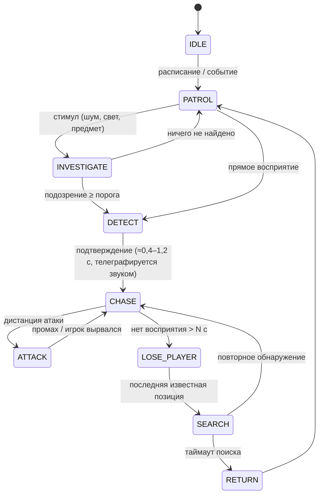

# Персонажи и враги

> Связано: [Сюжет](02_Story.md) · [3D assets](07_Asset_List.md) · [Техническая архитектура — AI](06_Technical_Architecture.md#8-enemy-ai)

---

## 1. VERITY-0 — главный персонаж и символ игры

### 1.1 Концепция

VERITY-0 — первый удачный экземпляр «честного компаньона» Solace Lightworks (1970). Это выставочная модель, в 3 раза больше серийной. Её образ — **маленькое солнце**: тёплое, круглое, домашнее. При этом это **точный прибор**: латунь, объективы, шкалы, гравировка, как у маякового или геодезического инструмента компании.

Характер: любопытная, буквальная, по-детски серьёзная. Речь VERITY выучила у Роуэна в годы Домашней программы (с 6 до 9 лет): короткие фразы, неожиданные вопросы, неправильные идиомы. **Солгать не может** (Аксиома Verity). Если правда запрещена или опасна, VERITY молчит и закрывает шторки глаз. Внутри неё хранятся воспоминания 340 человек, поэтому иногда она говорит *чужими* голосами.

**Ключевые силуэты (читаются в темноте):**

| Силуэт | Когда | Читаемость |
|---|---|---|
| **Сфера** | обычное движение (катится) | круг + 2 тёплые точки глаз |
| **Солнце** | эмоции: лепестки-лучи раскрыты | круг с короной из 12 лучей |
| **Тренога** | подъём, угроза: выдвинуты 3 ноги | сфера на высоких тонких опорах (2,4 м) — тревожный «геодезический» силуэт |
| **Цветок** (искажённая) | гл. 3–4 | оболочка раскрыта по 4 швам, лезвия, белое ядро |

### 1.2 Дизайн и пропорции

| Элемент | Описание | Размер |
|---|---|---|
| Оболочка | 2 полусферы из штампованной стали, эмаль **Solace Yellow** + лаковое покрытие (clear coat) | Ø 110 см |
| Экваториальный пояс | Шлифованная латунь, гравировка «SOLACE LIGHTWORKS · VERITY · MODEL 0 · SERIAL V-000», заклёпки | высота 8 см |
| Корона-лепестки | 12 лучевидных лепестков. Снаружи эмаль, внутри латунь с рядом крошечных ламп-бусин. В покое складываются в пазы верхней полусферы | 28 × 9 см каждый |
| Визор | Изогнутое окно из дымчато-янтарного стекла в верхней передней части | 52 × 22 см |
| Глаза (×2) | Объективные блоки: стеклянный купол, ирисовая диафрагма (8 лепестков), кольца объектива со шкалой, эмиссионный «зрачок» (тёплое бело-золотое). Верхние и нижние шторки-веки — изогнутые металлические пластины | Ø 16 см |
| «Рот» | Щель динамика под визором: решётка + янтарная световая полоса из 9 сегментов (визуализация речи, как VU-метр) | 30 × 4 см |
| Макушка | Латунное кольцо-ручка, вентиляционная крышка, табличка серийного номера | Ø 14 см |
| Низ | Резиновый ходовой пояс (почти не виден) | — |
| Сервисный люк | На спине, трафарет «DO NOT OPEN — MERIDIAN STAFF ONLY», логотип-солнце Solace | 30 × 30 см |
| Ноги (скрыты) | 3 телескопические ноги, как у геодезического штатива: латунь + воронёная сталь, 4 сегмента, ступни-шипы | до 2,4 м в треноге |
| Ядро (скрыто) | Гранёный кристалл тихостекла в латунном кардане (гироскоп), светится сквозь швы при эмоциях | Ø 30 см |

**Правило пропорций:** визор и глаза занимают верхнюю треть передней полусферы. Глаза крупные (≈15% диаметра) и широко расставлены — это «детская» схема лица, она вызывает доверие. В страшном состоянии ту же схему ломают: глаза сужаются диафрагмой, визор тёмный.

### 1.3 Состояния (варианты модели)

| Вариант | Ассет | Глава | Отличия |
|---|---|---|---|
| **Normal** | `SK_VERITY_Normal` | 1–2 | Чистая эмаль, лёгкая патина, мелкие царапины, тёплое свечение |
| **Damaged** | `SK_VERITY_Damaged` | 2 (конец) – 3, 4 (после очищения) | Вмятина на верхней полусфере; треснувший визор (левая сторона); 3–7 лепестков отсутствуют или погнуты (зависит от собранных «Солнечных лепестков»); сколы эмали до красного грунта и стали; правая диафрагма заедает и мерцает; пролом на спине-справа — видно ядро; свисающие провода в тканевой оплётке; соляной налёт (после гл. 3) |
| **Corrupted** | `SK_VERITY_Corrupted` | 3 (финал) – 4 | Оболочка раскрыта по 4 меридиональным швам, как лепестки цветка; внутри — проросшие бело-золотые кристаллы и десятки маленьких глаз-объективов от других VERITY; лепестки вытянуты в лезвия; тренога + 3 дополнительных тонких манипулятора; эмаль выцвела до бледной, эмиссия — резкий белый |
| **Cinematic** | `SK_VERITY_Cinematic` | катсцены | Та же топология, что у Normal/Damaged, но выше подразделение, геометрические заклёпки и гравировка, толщина стекла визора, преломляющее тихостекло, 4K-текстуры (UDIM), дополнительные морфы век и диафрагм |

Серийные **VERITY Home** (Ø 38 см, 6 лепестков, без ног) — сотни экземпляров в окружении. Три расцветки: *Solace Yellow*, *Dawn Orange*, *Noon Pale*. Есть вариант в коробке.

### 1.4 Качество модели (требования)

| Параметр | Game (LOD0) | Cinematic |
|---|---|---|
| Треугольники | ~60k (LOD1 30k, LOD2 12k, LOD3 4k) | ~250k |
| Топология | Квады, подразделяемая; управляющие петли у всех швов, вокруг визора и глаз. Отдельные меши: глаза, лепестки, веки, ноги, ядро | то же + геометрическая детализация |
| Сферичность | Силуэт не должен «граниться» на 1080p и в упор: ≥128 сегментов по экватору у LOD0 | ≥256 |
| UV | UV0: без растяжений, тексель 2048 px/м для оболочки; UDIM-подход для кинематографической версии | 4 UDIM × 4K |
| Текстурные наборы | Shell (4K), Trim/Brass (2K), Eyes (2K), Core (1K) — BaseColor / Normal / ORM / Emissive / маски повреждений | 4K все |
| Коллизия | Физический ассет: 1 сфера (корпус) + капсулы ног | — |

### 1.5 Материалы и шейдинг

| Материал | Модель шейдинга | Ключевые параметры |
|---|---|---|
| `M_VERITY_Shell` (master) | Clear Coat | Слои через маски: эмаль (roughness 0.3–0.4) → грунт (красный оксид) → сталь (metallic) → грязь/сажа (AO + world-space) → соль (гл. 3+) → влага. Параметры в MI на каждое состояние |
| `M_VERITY_Brass` | Default Lit, metallic | Анизотропные царапины через normal, патина в углублениях (curvature) |
| `M_VERITY_Eye` | Стекло: Thin Translucent / Default Lit | Купол с френелем и преломлением; диафрагма — металл; зрачок — emissive + лёгкая искажённая «линза»; параметр открытия диафрагмы |
| `M_VERITY_Visor` | Translucent (LOD0) / Masked-dither (LOD1+) | Дымчатый янтарь, трещины (маска + normal) |
| `M_Stillglass` | Translucent с преломлением (близко) / Opaque с parallax interior (далеко) | «Каустики памяти» — анимированный шум + interior mapping; цвет управляется параметром эмоций |
| `M_VERITY_MouthBar` | Unlit emissive | 9 сегментов, значение из амплитуды голоса (lipsync curve) |

**Проверочные сцены освещения** (обязательный тест качества в Phase 3): нейтральный студийный HDRI · тёмный коридор + фонарь игрока · красное аварийное освещение · натриевый янтарь цеха · холодный флуоресцент · кинематографический контровой свет. VERITY должна читаться во всех шести.

### 1.6 Риг

Один скелет **`SKEL_VERITY`** для всех состояний, поэтому анимации переиспользуются.

```
root
└─ body_pivot              (процедурное качение / наклон)
   ├─ shell_upper ─ visor
   │  ├─ eye_L ─ iris_L, lid_L_up, lid_L_dn
   │  ├─ eye_R ─ iris_R, lid_R_up, lid_R_dn
   │  └─ petal_01 … petal_12  (по 2 кости: base, tip)
   ├─ shell_lower
   ├─ seam_01 … seam_04     (раскрытие оболочки — Corrupted)
   ├─ core                  (кардан ядра)
   ├─ leg_A/B/C: hip → upper → slide_1 → slide_2 → foot   (телескоп + IK)
   └─ arm_X1/X2/X3: base → mid → tip                      (только Corrupted)
```

- **Control Rig `CR_VERITY`:** качение из скорости (угол = путь / радиус), наклон по ускорению, IK ног по трассировке поверхности, look-at глаз с микро-саккадами, «дыхание» ядра.
- **Система выражений:** Pose Asset + анимационные кривые. Они управляют веками, диафрагмами, лепестками, позой визора и параметрами материалов: цветом и яркостью ядра, сегментами «рта». Базовые эмоции: *Neutral, Curious, Happy, Sad, Afraid, Angry, Glitch, Dead*. Смешиваются аддитивно.
- **Anim Blueprint `ABP_VERITY`:** state machine локомоции (Rolling / Tripod / Airborne / Scripted), слой выражений, аддитивный глитч, слоты монтажей (Interact, Attack, Jumpscare, Death).

### 1.7 Анимации

| Категория | Ассеты |
|---|---|
| Idle | `AS_VERITY_Idle_Neutral`, `_Idle_Curious` (покачивание, взгляд по сторонам), `_Idle_Afraid` (лепестки прижаты, дрожь), `_Idle_Damaged` (заедающая диафрагма) |
| Movement | `BS_VERITY_Roll` (0–600 см/с), `AS_VERITY_Roll_Start/Stop/Turn180`, `AS_VERITY_Hop_Small` (через порог), `AS_VERITY_Tripod_Unfold/Fold`, `BS_VERITY_Tripod_Walk`, `AS_VERITY_Tripod_Climb` |
| Interaction | `AM_VERITY_Interact_ProjectLight` (освещает путь), `_Nudge` (толкает объект), `_PetalPoint` (лепестком указывает направление), `_Answer_Yes/No/Silent` |
| Attack (Corrupted) | `AM_VERITY_Attack_PetalSlash`, `_Lunge`, `_Grab` (манипуляторы) |
| Chase | `AS_VERITY_Chase_RollFast`, `BS_VERITY_Tripod_Run`, `AS_VERITY_Chase_WallScramble` |
| Jumpscare | `AM_VERITY_Jumpscare_Bloom` (раскрытие в камеру), `_Jumpscare_Drop` (падение сверху на треноге) |
| Death / поражение | `AM_VERITY_Death_LightFade` (концовка A), `_Shatter` (вариант гибели игрока), `_Purge` (очищение, гл. 4) |
| Cinematic | Отдельные клипы под каждую катсцену: «Голос в лифте», «Трещина», «Кровь солнца», «Очищение», «Сердце» и др. (см. [02](02_Story.md)) |

### 1.8 Голос

Детский голос (озвучивает ребёнок или взрослый актёр с обработкой — решить в препродакшене аудио) + обработка «динамик 70-х + стеклянный резонанс». В искажённом состоянии голос накладывается на голоса Марты, рабочих и детей.

---

## 2. Человеческие персонажи

| Персонаж | Внешность | Где виден | Модель |
|---|---|---|---|
| **Роуэн Вейл** | Только руки: рабочие перчатки, рукав куртки Hartwell с отражающей полосой, часы | всегда (FP) | `SK_FP_Arms` |
| **Десмонд Колдер** | ~60 лет, высокий, седая щетина, старое пальто охраны Solace без нашивок, револьвер, фонарь | гл. 3 (Отзвук), гл. 5 (лично) | Human (MetaHuman + кастомная одежда) |
| **Айона Сейбл** | ~70 лет, худая, коротко стриженные седые волосы, лабораторный халат поверх свитеров, очки с треснувшей линзой, УФ-ожоги на руках | гл. 4 | Human (MetaHuman) |
| **Марта Вейл** | 30 с небольшим, рабочий комбинезон линии лакировки, волосы под косынкой, жёлтая краска на пальцах | Отзвуки, Реестр | Human → материал Отзвука |
| **Огастин Мерсер** | Портреты 1930–70-х; в гл. 5 — силуэт из света: костюм-тройка 30-х, нимб-лучи | портреты, Отзвук, финал | Human → материал Света |
| Отзвуки рабочих (~12 вариантов) | Комбинезоны, халаты, форма охраны, семьи на экскурсии | гл. 3–5 | Модульные human-меши + материал Отзвука |

---

## 3. Враги и угрозы

### 3.0 Общая архитектура ИИ (кратко)

Все враги наследуют общий фреймворк (подробно: [06 §8](06_Technical_Architecture.md#8-enemy-ai)):

**Состояния:** `IDLE → PATROL → INVESTIGATE → SEARCH → DETECT → CHASE → ATTACK → LOSE_PLAYER → RETURN`



**Принципы честности ИИ:**
1. Враг знает только то, что воспринял его сенсор: зрение, слух или особое чувство, описанное ниже и **понятное игроку**.
2. Поиск идёт от **последней известной позиции** (Last Known Position) и через EQS-точки укрытий рядом с ней. Текущая позиция игрока ИИ не известна.
3. **Подозрение копится:** короткий взгляд — это INVESTIGATE, а не мгновенная погоня. Переход в DETECT всегда телеграфируется звуком или анимацией.
4. **Уровни агрессии** (Calm / Alert / Hunting / Frenzied) меняют скорость, пороги и длительность поиска. Скриптовые события главы могут повышать уровень, но не дают ИИ знаний.

### 3.1 Сводная таблица

| # | Угроза | Глава | Восприятие | Правило для игрока | Тип |
|---|---|---|---|---|---|
| 1 | **Фонарщик** (The Lamplighter) | 1, камео 5 | Видит **источники света**; слух средний | Не свети — он идёт на свет | Systemic stalker |
| 2 | **Слушатель** (The Listener) | 2 | **Только слух**, на потолочных рельсах | Тише; где нет рельсов, там безопасно | Systemic stalker |
| 3 | **Экзаменатор** (The Proctor) | 2 | — (скрипт) | Отвечай правду | Puzzle-boss |
| 4 | **Просоленные** (The Saltbound) | 3 | Слух, тепло вблизи; **замирают в луче** | Свет — защита, но батарея конечна | Systemic group |
| 5 | **Проходчик** (The Delver) | 3 | Чует **тихостекло** (линза Памяти) | Не пользуйся линзой рядом | Set-piece chase |
| 6 | **Отзвуки паники** | 3–5 | — | Не стой в них: падает Ясность | Hazard |
| 7 | **SOLACE** | 4–5 | Зрение (лучше в свете), слух, «чувство памяти» | Её свет стирает, а не убивает | Systemic stalker |
| 8 | **Хор** (The Choir) | 4 | Зрение 360° на короткой дистанции, слух | Рвать дистанцию, ломать линию взгляда | Chase + split |
| 9 | **Искажённая VERITY** | 3–4 | Зрение, слух, «связь» | Связь телеграфируется — уходи из зоны | Systemic stalker |
| 10 | **Свет Основателя** | 5 | Прожекторы-«взгляд» | Головоломка-арена | Boss-environment |
| 11 | **Десмонд Колдер** | 5 | Зрение (фонарь), слух | Человек: ошибается, устаёт, говорит вслух | Human stalker |

---

### 3.2 Фонарщик (The Lamplighter) — Глава 1

**Лор.** Сервисный автомат L-4 (1950-е) обслуживал лампы под потолками цехов. Свет Долгого Полдня «переписал» его единственную инструкцию: *каждый свет должен гореть там, где положено*. Любой свет «не на месте» — нарушение, которое нужно погасить. Вместе с его носителем.

**Силуэт.** Тонкая телескопическая мачта (2,2 м в сложенном виде, до 5 м в выдвинутом) на двух голенастых ногах-ходулях с обратным суставом, как у журавля. «Голова» — латунная клетка-фонарь с огромной лампой накаливания за линзой Френеля: это его глаз. Правая рука — длинный шест с крюком для ламп (захват). Левая — колокол-гаситель. Поверх мачты — рваный прорезиненный фартук.
**Материалы:** промышленная зелёная эмаль, латунь, стекло, ржавчина, сажа.

| Параметр | Значение (Standard) |
|---|---|
| Зрение | Видит **источники света** (фонарь игрока, шашки, лампы) до 35 м, конус 70°. Игрока без света замечает только вблизи (3 м) или силуэтом на фоне освещённого проёма |
| Слух | Бег 12 м, шаг 4 м, присед 1,5 м |
| Особое | «Карта ламп»: помнит, какие лампы должны гореть. Если игрок переключил лампу, он идёт проверить — механика отвлечения |
| Скорость | Патруль 120 см/с, погоня 420 см/с (бег игрока 450) |
| Атака | Захват крюком (дистанция 2,5 м) → смерть-катсцена |
| Уровни агрессии | Calm (обслуживает лампы, насвистывает) → Alert (свист обрывается) → Hunting (мачта выдвинута, лампа-глаз раскалена) |
| Контригра | Выключить фонарь, уйти в тень, отвлечь лампами, закрыть противопожарную шторку, спрятаться в шкафчике |
| Поражение | Не убивается. В кульминации гл. 1 сбит с рельса и придавлен. Камео в гл. 5 |
| Звуковой отпечаток | Скрип телескопа, гул нити накаливания, звон цепи крюка, **свист джингла Solace 50-х** |

**Анимации:** patrol walk, tend lamp (зажигает и гасит), alert (поворот головы-фонаря), mast extend/retract, run, peek over catwalk, hook attack, kill sequence, stagger, fall.

### 3.3 Слушатель (The Listener) — Глава 2

**Лор.** Акустический массив AS-7 следил за Слушающими комнатами: каждое слово испытуемых записывалось. Протоколы «слушания» VERITY проросли в него.

**Силуэт.** Перевёрнутая люстра из 12 латунных рупоров разного размера на тележке, бегущей по потолочному двутавру. Две длинные суставчатые руки с клешнями-микрофонными стойками, свисающие кабели-«щупальца». Может опускать корпус на телескопе до уровня пола.

| Параметр | Значение |
|---|---|
| Зрение | **Нет** |
| Слух | Распространение звука по комнатам (окклюзия через двери). Металлические решётки — громко, ковёр — тихо. Бег 18 м, шаг 6 м (решётка) / 2 м (ковёр), присед 1 м, брошенный предмет 10–15 м, воспроизведение диктофона — громкость по настройке |
| Особое | **«Вслушивание»:** замирает, все рупоры медленно поворачиваются. Игрок должен не двигаться и задержать дыхание (выносливость). На Harrowing слышит дыхание в радиусе 2 м |
| Ограничение | Существует **только там, где есть рельсы**. Рельсы всегда видны — правило зоны опасности читается сразу |
| Атака | Клешни опускаются, захват → смерть |
| Контригра | Мягкие поверхности, приседание, диктофон как приманка, закрытые двери, шум паровых клапанов маскирует шаги |
| Поражение | Стрелка рельсов — падение в шахту лифта (кульминация гл. 2) |
| Звук | Шорох вращения рупоров, щелчки реле, тихий **эхо-повтор звуков игрока**: он «переигрывает» услышанное |

### 3.4 Экзаменатор (The Proctor) — Глава 2

Машина-судья Зала испытаний: массивный стол-пульт, манекен-торс, игла полиграфа на длинной руке, считыватель перфокарт, голова-проектор, выводящая вопросы на экран. Не преследует. Задаёт вопросы, «судит» ответы и управляет шлюзами зала (см. головоломку гл. 2). Анимации: пробуждение, вопрос, «размышление» (игла дрожит), вердикт верно/неверно, перегрузка.

### 3.5 Просоленные (The Saltbound) — Глава 3

**Лор.** 129 пропавших в Долгий Полдень ушли в шахту. Соль и пыль тихостекла сохранили их тела. Остаточный свет памяти «водит» их: они повторяют последние движения, а в темноте тянутся к теплу и звуку.

**Силуэт.** Человеческие фигуры в одежде 1986 года (комбинезоны, халаты, форма охраны, нарядная одежда для Дня семьи), покрытые бело-розовой кристаллической коркой. Лица — соляные маски, за прорезями глаз тлеет свет. Движения рваные, с хрустом кристаллов.

| Параметр | Значение |
|---|---|
| Зрение | Нет |
| Слух | Средний; тепло — 4 м |
| Особое | **Замирают в прямом луче фонаря** (кристаллы твердеют). Луч удерживает одного: батарея тратится в 2 раза быстрее. Сигнальная шашка замораживает всех в радиусе 8 м на 20 с |
| Бюджет | Не более 3 активных одновременно (остальные — декорация, которая «может ожить» по триггеру директора) |
| Атака | Захват → корка ползёт по рукам → смерть |
| Контригра | Свет на того, кто ближе; пятиться; шашки; тёмные обходы |
| Звук | Хруст соли, шёпот обрывков фраз 1986 года |

### 3.6 Проходчик (The Delver) — Глава 3

**Лор.** Проходческий комбайн 60-х Solace-Harrow. Его оснастили «глазом» тихостекла, чтобы он находил жилы. Теперь он ищет тихостекло везде — в том числе осколок в фонаре Роуэна.

**Силуэт.** Гусеничная машина 14 × 6 м, вращающийся режущий барабан с резцами, пылевой кожух, кабина оператора с горящим стеклянным «глазом», хвостовой конвейер.

| Параметр | Значение |
|---|---|
| Восприятие | Каждое использование линзы Памяти — «пинг» позиции с радиусом 30 м (телеграфируется гулом и дрожью кристаллов на стенах) + слух на сильные звуки |
| Поведение | Полусистемный: патрулирует выработки и прорезает новые проходы по сплайнам. Две полностью срежиссированные погони (chase director) |
| Атака | Касание барабана — смерть |
| Поражение | Обрушение берега солёного озера |
| Звук | Низкий рёв, скрежет резцов о соль, пылевой шквал (Niagara) |

### 3.7 Отзвуки паники — Главы 3–5

Световые слепки самых ярких моментов Долгого Полдня. Видны через линзу Памяти (у сильных жил — и без неё). Нарративные Отзвуки безопасны. Отзвуки паники — бегущая толпа, крик, вспышка — при контакте **снижают Ясность**. Иногда они перекрывают путь, и проходить нужно по таймингу. Иногда сами **показывают** путь: беглецы 1986 года знали выход.

### 3.8 SOLACE — Главы 4–5

**Лор.** Модель S-0 (1974), «утешитель». Её «Милосердный свет» стирает болезненные воспоминания. Голос и руки Света Основателя.

**Силуэт.** Фарфорово-белая сфера Ø 90 см с бледно-голубым серебристым отливом. Одна горизонтальная **щель-глаз**, как прорезь почтового ящика, из неё — холодный голубой свет. Вместо лепестков — тонкое кольцо-полумесяц, медленно вращающееся вокруг корпуса. **Катится абсолютно беззвучно.** Перемещается и по сети пневмопочты Аннекса: появляется из люков с шипением.

| Параметр | Значение |
|---|---|
| Зрение | Конус 110°, 25 м в освещённых зонах, 8 м в темноте |
| Слух | Средний |
| Особое | **Чувство памяти:** использование линзы Памяти в радиусе 20 м выдаёт позицию. Шипение пневмолюков и колыбельная — единственные звуковые подсказки игроку |
| Атака | **Милосердный свет:** ≥1,5 с в луче → событие **Забвения** (стирается текущая цель, метки, последние 1–3 страницы журнала, название случайного ключевого предмета; падает Ясность). Третий захват за 5 минут → «выбеливание» (смерть) |
| Контригра | Ломать линию взгляда, темнота, **стробоскоп** (оглушение 4 с, ограниченные заряды), правда на плёнках диктофона |
| Финальная форма | **«Затмение»** (гл. 5): слияние со Светом Основателя, нимб растёт до 6 м, несколько лучей |
| Звук | Тишина. Колыбельная-джингл, напеваемая шёпотом. Шипение пневмопочты |

### 3.9 Хор (The Choir) — Глава 4

**Лор.** Провальные прототипы VERITY-1…11, брошенные в Хранилище прототипов. Тихостекло срастило их в один катящийся кластер.

**Силуэт.** Гроздь из 11 сфер разного размера (30–90 см) и цвета: серый грунт, красный тестовый, неокрашенный алюминий, зелёный. У каждой своё «лицо» — разные ранние дизайны глаз. Сферы вращаются независимо, кластер перекатывается рывками. Общий размер ~3 м. В широких залах **распадается** на 2–3 малых кластера и снова сливается.

| Параметр | Значение |
|---|---|
| Зрение | 360°, но только 12 м (у каждой сферы свой короткий конус) |
| Слух | Высокий |
| Поведение | Погоня + разделение для окружения в больших залах (EQS-фланг) |
| Поражение | Заперт в Хранилище гермодверью (кульминация погони) |
| Звук | **Джингл Solace на 11 голосов**, расстроенный, с гармоническими биениями |

### 3.10 Искажённая VERITY — Главы 3 (финал) – 4

| Параметр | Значение |
|---|---|
| Зрение | 30 м, конус 90° |
| Слух | Высокий |
| Особое — **«Связь»** | Раз в ~90 с VERITY получает **приблизительную зону** игрока (радиус 15 м). Механика видима: за 3 с до пинга жёлтая подсветка фонаря мерцает, слышен шёпот «Роуэн?». Игрок может уйти из зоны или спрятаться. Это не всезнание, а телеграфируемое правило |
| Атака | Удар лепестками-лезвиями, рывок, захват манипуляторами |
| Поведение | Тренога: ходит по стенам и потолку коротких участков (navmesh-«прыжки» по заданным точкам). Зовёт голосами Марты и детей |
| Поражение | Не убивается: очищение в Лаборатории отпечатков |

### 3.11 Свет Основателя — Глава 5

Антагонист-среда. Отпечаток Мерсера в Сердце управляет прожекторами Меридиана: это его «взгляд». Он вращает кольца Армиллярия, будит Отзвуки. В ключевых катсценах проявляется как силуэт из света высотой ~12 м: мужчина в костюме 30-х с нимбом-лучами. Финальная «битва» — головоломка-арена: игрок вращает кольца и уходит от лучей.

### 3.12 Десмонд Колдер — Глава 5

Человек-противник на том же AI-фреймворке: зрение через фонарь (конус луча), слух. Устаёт: после погони идёт медленнее. **Говорит вслух** (bark-система): «Я знаю, что вы здесь», «Мне не нужен ваш журнал». Так игрок слышит его состояние. Не стреляет без прямой видимости; первый выстрел — предупредительный (дизайн-правило). Конец — катсцена, исход вариативный (см. [02 §4, гл. 5](02_Story.md)).

### 3.13 Атмосферные (не атакуют)

| Угроза | Суть |
|---|---|
| **Пустые оболочки** | Пустые корпуса VERITY Home. Поворачиваются «лицом» к игроку, когда тот не смотрит. Только скрипт директора напряжения, редко |
| Паровые клапаны, искрящие кабели | Опасность среды, маскировка шума |
| Обрушения, затопление | Скриптовые set-pieces |

---

## 4. Уровни агрессии — сводная настройка

| Уровень | Скорость | Порог подозрения | Длительность поиска | Где применяется |
|---|---|---|---|---|
| Calm | ×0.8 | ×1.3 | 15 с | начало зоны, после передышки |
| Alert | ×1.0 | ×1.0 | 30 с | после первого обнаружения в зоне |
| Hunting | ×1.15 | ×0.8 | 60 с | после повторных обнаружений, сюжетные моменты |
| Frenzied | ×1.3 | ×0.6 | до потери / таймаут 90 с | кульминации, погони |

Уровень постепенно снижается, если игрок долго не обнаружен (decay). Иначе напряжение «залипает».
