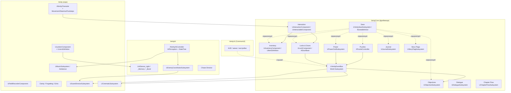

# Техническая архитектура

> Документ определяет, **как** строится проект. Решения здесь обязательны для всех следующих фаз. Изменения — только осознанно, с записью в §17 «Журнал решений».

---

## 1. Принципы

1. **C++ — для систем, Blueprints — для контента.** Логика, состояние, сериализация, ИИ-решения — в C++. Настройка, раскладка, визуальная «склейка», уникальные сценарные моменты — в BP-наследниках.
2. **Data-driven.** Предметы, цели, профили врагов, линзы, документы, диалоги — Data Assets и Data Tables. Новый контент не требует нового кода.
3. **Слабая связность.** Системы общаются через **шину событий на GameplayTags** и интерфейсы, а не через жёсткие ссылки на акторы.
4. **Всё, что меняется в мире, сохраняется.** Каждый stateful-актор реализует `ISaveableActor` со стабильным GUID.
5. **Event-driven, не Tick-driven.** Tick — только там, где без него нельзя (движение, камера, восприятие). Иначе — таймеры и события.
6. **Тестируемость.** Каждая система — с functional test-картой или automation-тестом и отладочным оверлеем.
7. **Бюджеты с первого дня** (см. §12). Производительность не «оптимизируют в конце» — её держат.

## 2. Движок, платформа, железо

| Параметр | Решение |
|---|---|
| Движок | **Unreal Engine 5** — последняя стабильная 5.x на момент Phase 2 (минимум 5.5). Версия фиксируется в `.uproject`. Апгрейд — отдельная задача с веткой и регресс-тестами |
| Язык | C++20 (стандарт UE) + Blueprints |
| RHI | DirectX 12, Shader Model 6 |
| IDE | Visual Studio 2022 (или Rider) |
| Цели FPS | 60 FPS — High @ 1080p на RTX 3060 / RX 6600 XT (TSR, 67% screen%); 60 FPS — High @ 1440p на RTX 4070 |
| Минимальные требования | GTX 1660 Super / RX 5600 XT, 6 GB VRAM, 6-ядерный CPU, 16 GB RAM, SSD. Preset Low: Lumen выключен, 30+ FPS @ 1080p |

## 3. Структура репозитория

```
/                              ← корень репозитория = корень Unreal-проекта
├─ Verity.uproject
├─ CLAUDE.md                   ← правила проекта для Claude Code
├─ Config/                     ← DefaultEngine/Game/Input/Scalability.ini
├─ Source/
│  ├─ Verity/                  ← игровой модуль: персонаж, фонарь, gameplay-фичи глав
│  ├─ VerityCore/              ← фреймворк без зависимости от контента: interaction, inventory,
│  │                              save, objectives, power, puzzles, locks, journal, event bus
│  ├─ VerityAI/                ← ИИ: контроллер, StateTree-задачи, сенсы, координатор, chase
│  ├─ VerityUI/                ← CommonUI-виджеты (C++ базы), HUD, меню, настройки
│  └─ VerityEditor/            ← editor-only: валидаторы ассетов, утилиты, импорт-пресеты
├─ Plugins/                    ← сторонние и собственные плагины (если появятся)
├─ Content/                    ← только .uasset/.umap (LFS)
├─ Art/                        ← исходники DCC (LFS): .blend, high-poly, исходные текстуры
│  ├─ Source/<Category>/<Asset>/
│  └─ Export/<Category>/<Asset>/   ← FBX + текстуры, готовые к импорту
├─ Audio/Source/               ← исходные WAV (LFS)
├─ Tools/
│  ├─ Blender/                 ← Python-пайплайн Blender (генерация, валидация, экспорт)
│  └─ Unreal/                  ← Python editor-скрипты (пакетный импорт, проверки)
└─ Docs/                       ← дизайн и техническая документация
```

### 3.1 Структура `Content/`

Верхний уровень — ровно как в ТЗ, плюс `Core/` и `Data/`. Сторонние паки с Fab/Marketplace устанавливаются в собственные папки и **никогда не смешиваются** с нашими. Нужное из паков мигрируется и переименовывается по конвенции.

```
Content/
├─ Characters/
│  ├─ Verity/          { Meshes/ Materials/ Textures/ Rig/ Animations/ Blueprints/ }
│  ├─ VerityHome/      (серийные единицы)
│  ├─ Solace/
│  ├─ Player/          (FP-руки)
│  └─ Humans/          { Calder/ Sabel/ Marta/ Mercer/ EchoCrowd/ }
├─ Enemies/
│  ├─ _Shared/         (базовые BP, общие материалы)
│  ├─ Lamplighter/  Listener/  Proctor/  Saltbound/  Delver/  Choir/  FoundersLight/
├─ Environment/
│  ├─ _Shared/         (утилиты: трубы, кабели, вентиляция, лестницы, перила, двери)
│  ├─ Ch1_LampHalls/   { Kit/ Props/ Decals/ }
│  ├─ Ch2_Research/    { Kit/ Props/ Decals/ }
│  ├─ Ch3_Undercroft/  { Kit/ Rock/ Props/ Decals/ }
│  ├─ Ch4_Annex/       { Kit/ Props/ Decals/ }
│  └─ Ch5_Meridian/    { Kit/ Props/ Decals/ }
├─ Materials/          { Master/ Functions/ Parameters(MPC)/ PostProcess/ Library(общие MI)/ }
├─ Textures/           { Shared/ Trims/ Grunge/ Noise/ LUTs/ IES/ }
├─ Animations/         { FirstPerson/ Shared/ }     (анимации персонажей — у персонажей)
├─ Audio/              { Ambience/ Music/ SFX/ Voice/{EN,RU}/ MetaSounds/ Mix/ Attenuation/ }
├─ VFX/                { Niagara/ Materials/ Textures/ }
├─ UI/                 { Widgets/ Styles/ Fonts/ Textures/ Icons/ }
├─ Blueprints/         { Core/ Player/ Interactables/ Doors/ Power/ Security/ Gameplay/ }
├─ Systems/            { AI/{StateTrees, EQS, Profiles} Save/ Input/ Cinematic/ Scare/ }
├─ Levels/             { MainMenu/ Ch1/ Ch2/ Ch3/ Ch4/ Ch5/ Test/ }
├─ Cinematics/         { Ch1/ … Ch5/ Shared/ }
├─ Items/              { Definitions/ Meshes/ Materials/ }
├─ Puzzles/            { Ch1_KilnLine/ Ch2_TruthTrial/ Ch3_BrineLake/ Ch4_ImprintLab/ Ch5_Armillary/ Shared/ }
├─ Core/               { GameModes/ GameInstance/ Settings/ }
└─ Data/               { Tags/ Objectives/ Dialogue/ Documents/ AudioLogs/ StringTables/ Chapters/ }
```

## 4. Конвенции имён

Формат: `Prefix_AssetName_Variant_Suffix` в **PascalCase**, без пробелов и кириллицы.

| Тип | Префикс | Пример |
|---|---|---|
| Blueprint | `BP_` | `BP_Door_Industrial_Sliding` |
| Blueprint Interface | `BPI_` | `BPI_Interactable` |
| Static Mesh | `SM_` | `SM_Ch1_Wall_Brick_400x400_A` |
| Skeletal Mesh | `SK_` | `SK_VERITY_Damaged` |
| Skeleton | `SKEL_` | `SKEL_VERITY` |
| Physics Asset | `PHYS_` | `PHYS_VERITY` |
| Anim Blueprint | `ABP_` | `ABP_VERITY` |
| Anim Sequence / Montage / BlendSpace | `AS_` / `AM_` / `BS_` | `AM_VERITY_Jumpscare_Bloom` |
| Control Rig / IK Rig / Pose Asset | `CR_` / `IKR_` / `PA_` | `CR_VERITY` |
| Material / Instance / Function | `M_` / `MI_` / `MF_` | `MI_VERITY_Shell_Damaged` |
| Material Parameter Collection | `MPC_` | `MPC_Lens` |
| Texture | `T_` + суффикс | `T_VERITY_Shell_BC`, `_N`, `_ORM`, `_E`, `_M` (маска) |
| Niagara System / Emitter | `NS_` / `NE_` | `NS_DustMotes_LightShaft` |
| MetaSound Source / Patch | `MSS_` / `MSP_` | `MSS_Lamplighter_Whistle` |
| Sound Wave | `SW_` | `SW_VO_Calder_Ch1_004` |
| Sound Class / Mix / Attenuation / Concurrency | `SCL_` / `SMX_` / `ATT_` / `SCON_` | `ATT_Enemy_Large` |
| Level / Level Sequence | `L_` / `LS_` | `L_Ch1_Z05_ShellPress`, `LS_Ch1_VoiceInTheLift` |
| Widget | `WBP_` | `WBP_PauseMenu` |
| Data Asset / Data Table / Curve | `DA_` / `DT_` / `CRV_` | `DA_Item_Keycard_Amber`, `DT_Dialogue_Ch1` |
| StateTree / Behavior Tree / Blackboard / EQS | `ST_` / `BT_` / `BB_` / `EQS_` | `ST_Enemy_Base`, `EQS_SearchHidingSpots` |
| Input Action / Mapping Context | `IA_` / `IMC_` | `IA_LanternToggle`, `IMC_Default` |
| String Table | `STT_` | `STT_UI`, `STT_Documents_Ch2` |
| Functional test map | `FTEST_` | `FTEST_SaveLoad_Doors` |

**Суффиксы текстур:** `_BC` BaseColor (sRGB), `_N` Normal (DirectX), `_ORM` (R=AO, G=Roughness, B=Metallic, linear), `_E` Emissive, `_M` маски (каналы описываются в материале), `_H` Height.
**C++:** стандарт Epic (`U`/`A`/`F`/`I`/`E`-префиксы, `b` для bool). Теги — иерархические: `Item.Key.Keycard.Amber`, `Power.Circuit.Ch1.Boiler`, `AI.State.Chase`, `Story.Flag.Ch1.MetVerity`, `Event.Noise.Footstep`, `Puzzle.Ch1.KilnLine.Solved`.

## 5. Архитектура кода



### 5.1 Шина событий

`UVerityEventBus` (World Subsystem):
- `Broadcast(FGameplayTag Channel, const FVerityEvent& Payload)` — `Payload`: инициатор, цель, число, имя, `FInstancedStruct` для произвольных данных.
- `Listen(FGameplayTag Channel, Delegate, bExactMatch=false)` — подписка на ветку тегов (`Puzzle.Ch1` ловит все головоломки главы).
- Отладка: лог событий в Visual Logger + консольная команда `Verity.EventBus.Trace`.

### 5.2 Ключевые классы (по модулям)

| Модуль | Классы |
|---|---|
| **VerityCore** | `UVerityEventBus`, `IVerityInteractable`, `UInteractionComponent`, `UInteractableComponent`, `UInventoryComponent`, `UItemDefinition`, `ADoorBase`, `ULockComponent`, `ULockRequirement` (+ подклассы), `UPowerGridSubsystem`, `UPowerSourceComponent`, `UPowerConsumerComponent`, `ABreakerPanel`, `AFuseSocket`, `APuzzleController`, `UPuzzleElementComponent`, `UPuzzleCondition`, `UObjectiveSubsystem`, `UObjectiveDefinition`, `UJournalSubsystem`, `UDocumentDefinition`, `UAudioLogDefinition`, `UStoryFlagSubsystem`, `UVeritySaveSubsystem`, `UVeritySaveGame`, `ISaveableActor`, `USaveableComponent`, `UDialogueSubsystem`, `UChapterFlowSubsystem`, `UChapterDefinition`, `UEndingSubsystem`, `UCollectibleSubsystem` |
| **Verity** | `AVerityGameMode`, `AVerityPlayerController`, `AVerityCharacter`, `UVerityMovementComponent`, `UStaminaComponent`, `UFootstepComponent`, `ULanternComponent`, `ULensDefinition`, `ULightStimulusComponent`, `UFieldRecorderComponent`, `UClarityComponent`, `UForgettingSubsystem`, `AEchoActor`, `AHideSpot`, `UPhysicsGrabComponent`, `AThrowableItem`, `APunchClock`, `ASecurityCamera`, `ASecurityMonitorStation`, `ARailNetwork`/`ARailCart`/`ARailSwitch`, `ATubeNetwork`, `AWaterLevelController`, `AVerityCompanion`, `UScareDirectorSubsystem`, `AScareEvent`, `UCinematicSubsystem`, `ACinematicTrigger`, `UMusicSubsystem`, `AAmbienceZone`, `UVerityGameUserSettings`, `UVerityCheatManager` |
| **VerityAI** | `AVerityEnemyBase`, `AVerityAIController`, `UEnemyProfile`, `UThreatStateComponent`, StateTree-задачи/условия (`FSTT_Patrol`, `FSTT_Investigate`, `FSTT_Search`, `FSTT_Chase`, `FSTT_Attack`, `FSTT_ReturnToPatrol`, `FSTC_SuspicionAbove`…), `UAISense_Light`, `UAISense_Memory`, `UAISense_Bond`, `URailMovementComponent`, `UEnemyCoordinatorSubsystem`, `AChaseSequence`, `UChaseDirectorSubsystem`, `ASabelCompanion` |
| **VerityUI** | `UVerityHUDLayout`, `UVerityActivatableScreen` (база экранов), инвентарь, журнал, чтение документа, осмотр, субтитры, подсказки, меню, настройки, сохранения, титры |
| **VerityEditor** | `UVerityAssetValidator_Naming`, `_Textures`, `_StaticMesh` (коллизия/LOD/Nanite), `_SaveableGuid` (уникальность GUID на уровне) |

### 5.3 Встроенные плагины UE

Enhanced Input · CommonUI · StateTree + GameplayStateTree · Smart Objects · EQS · MetaSound · Audio Modulation · Niagara · Control Rig · IK Rig · Python Editor Script Plugin · Editor Scripting Utilities · Data Validation · Modeling Tools Editor Mode (грейбокс) · Movie Render Queue (трейлеры) · Chaos (геометрические коллекции — только для скриптовых обрушений).

Сознательно **не используем:** Gameplay Ability System (для хоррора без боёвки — избыточна), World Partition (см. §6), Water-плагин (для интерьерной воды — свои меши и материалы).

## 6. Уровни и стриминг

**Решение:** каждая глава — **persistent-уровень** + **стриминговые подуровни по зонам**. World Partition не используется.

Почему: World Partition стримит по сетке расстояний, а он создан для открытых миров. У нас интерьеры, уложенные друг над другом (шахта под цехами), и строго линейные «шлюзы». Классический Level Streaming даёт точный контроль памяти и загрузок в лифтах и туннелях. Для параллельной работы включаем **One File Per Actor** (External Actors).

```
L_Ch1_Persistent                 ← всегда загружен: менеджеры, PostProcess, SkyAtmosphere/Fog, PlayerStart, Audio-роутинг
├─ L_Ch1_Z01_Gate                ← геометрия + свет + декор зоны
├─ L_Ch1_Z01_Gate_GP             ← геймплей: триггеры, ИИ, головоломки, интерактивы
├─ L_Ch1_Z02_Lobby / _GP
├─ …
├─ L_Ch1_Audio                   ← эмбиент-зоны, звуковые объёмы
└─ L_Ch1_Cine                    ← актёры катсцен
```

- Загрузка: стриминговые объёмы + явные загрузки на «шлюзах» (дверь закрывается, следующая зона подгружается, предыдущая выгружается).
- Тестовые карты: `L_Test_Gym_Movement`, `L_Test_Gym_AI`, `L_Test_Gym_Puzzles`, **`L_Test_LookDev`** (6 эталонных сценариев освещения для ревью ассетов), `FTEST_*`.

## 7. Сохранения

Спецификация — [05 §11](05_Gameplay_Systems.md#11-saveload-checkpoints-punch-clocks). Технически:
- `USaveableComponent` хранит `FGuid` (генерируется при размещении, валидатор проверяет уникальность). Сериализация — через `FArchive` с флагом `SaveGame` для `UPROPERTY(SaveGame)`.
- Акторы, созданные в рантайме (выброшенные предметы), сохраняются с классом и трансформом. Уничтоженные размещённые акторы — список GUID.
- Асинхронная запись (`AsyncSaveGameToSlot`), версия формата и миграции.

## 8. Enemy AI

### 8.1 Стек

| Задача | Технология |
|---|---|
| Восприятие | **AIPerception**: Sight, Hearing + кастомные `UAISense_Light` (источники света и точки попадания луча), `UAISense_Memory` (использование линзы Памяти), `UAISense_Bond` (телеграфируемая «связь» VERITY) |
| Принятие решений | **StateTree** (`ST_Enemy_Base` + наследование и переопределение задач на врага). Логика задач, условий и эвалюаторов — в C++. Ассет StateTree — только «проводка» 9 состояний |
| Поиск точек | **EQS**: укрытия рядом с последней известной позицией, точки обзора, фланги для Хора |
| Навигация | NavMesh + Nav Modifiers + **Smart Nav Links** (двери, прыжки, «карабканье» VERITY). Особые: `URailMovementComponent` (Слушатель — по сплайнам рельсов), сплайн-движение Проходчика, пневмосеть SOLACE (Smart Objects) |
| Координация | `UEnemyCoordinatorSubsystem`: лимит активных врагов (Просоленные ≤ 3), токены атаки, разделение и слияние Хора, синхронизация с Chase и Scare Director |
| Отладка | Gameplay Debugger (своя категория: состояние, подозрение, LKP, стимулы), Visual Logger, StateTree Debugger |

### 8.2 Модель состояния

`UThreatStateComponent` хранит:
- текущее состояние — тег `AI.State.{Idle|Patrol|Investigate|Search|Detect|Chase|Attack|LosePlayer|Return}`;
- **подозрение** 0–1 по каждому стимулу (растёт от силы и длительности стимула, падает со временем);
- **LKP** (last known position) + время и тип стимула;
- **уровень агрессии** (`AI.Aggression.{Calm|Alert|Hunting|Frenzied}`) с decay.

Смена состояния публикуется в шину (`Event.AI.StateChanged`) — на неё реагируют музыка, Scare Director и UI отладки.

### 8.3 Профиль врага (`UEnemyProfile`, Data Asset)

Параметры чувств (дальность, конусы, пороги, множители поверхностей), скорости по состояниям, длительности поиска, параметры атаки, звуковой набор, множители уровней агрессии и сложности. Баланс меняется без перекомпиляции.

### 8.4 Правило честности

Ни одна задача StateTree не читает позицию игрока напрямую. Позиция игрока доступна ИИ **только** через перцепцию (stimulus location) и LKP. Исключение — срежиссированные погони (`AChaseSequence`) и телеграфируемый `UAISense_Bond`. Правило проверяется код-ревью и тестом: grep-проверка запрещённых вызовов в модуле VerityAI в CI.

## 9. Аудио-архитектура

```
Master
├─ SFX ─┬─ Player (шаги, руки, фонарь)
│       ├─ World (механизмы, двери, физика)
│       └─ Enemies
├─ Ambience (зоны, one-shots)
├─ Music (стемы MetaSound)
├─ Voice ─┬─ Dialogue (мир)
│         ├─ Radio (субмикс-эффект «рация»)
│         └─ Tapes (субмикс «плёнка»: wow/flutter, шум)
└─ UI
```

- Control Bus Mix для состояний: `Mix_ListeningRoom` (приглушение всего, «звон»), `Mix_LowClarity` (фильтры, смещение), `Mix_Cinematic`, `Mix_Pause`.
- Голоса VERITY и SOLACE — MetaSound-процессинг в реальном времени (параметр «искажения» управляется состоянием).
- Пространственный звук: стандартная спатиализация + HRTF как опция для наушников.

## 10. Кинематографика

- `LS_ChX_<Name>` в `Content/Cinematics/ChX/`. Каждая катсцена — свой мастер-сиквенс + сабсиквенсы по шотам (камера, свет, анимация, аудио, VFX).
- Камеры: Cine Camera Actor (реальные объективы 18–135 мм, диафрагма, фокус), рейлы, краны, ручная камера (шум через Camera Shake). Для каждой сцены — короткий **shot list** в `Docs/Cinematics/` перед производством.
- Свет в катсценах — отдельные Light-акторы в `L_ChX_Cine`, включаемые треком (Spawnable). Свет геймплея не правим.
- Переход игра ↔ катсцена: бленд камеры от FP-камеры к первому шоту и обратно (без жёстких склеек, где возможно).

## 11. Рендеринг и визуальные технологии

Каждая технология включена, потому что решает конкретную задачу, а не «ради названия».

| Технология | Где и зачем | Ограничения |
|---|---|---|
| **Lumen GI + Reflections** | Динамический свет повсюду: фонарь игрока, аварийка, мерцание, выключение цепей питания. Запечённый свет здесь невозможен | Software RT по умолчанию; Hardware RT — опция High/Epic. На Low Lumen выключен (SSGI / без GI + доп. fill-свет в уровне) |
| **Nanite** | Статичное окружение: modular kits, соляные скалы и кристаллы, плотный декор, кольца Меридиана | Не для скелетных мешей, не для полупрозрачных материалов. Для масок — только где нужно |
| **Virtual Shadow Maps** | Качественные тени от динамических источников, особенно от фонаря по Nanite-геометрии | Лимит: ≤ 6 теневых локальных источников в кадре; остальные — без теней или с contact shadows |
| **Niagara** | Пыль в лучах, искры, пар, соляная взвесь, капли, частицы Отзвуков, пыль Проходчика, ядро VERITY | GPU-эмиттеры, бюджеты по главе, LOD/culling по дистанции |
| **Volumetric Fog + Local Fog Volumes** | Лучи из пилообразных фонарей (гл. 1), туман шахты (гл. 3), Солнечная шахта (гл. 5) | Качество — по scalability; не во всех зонах |
| **Post Process** | Тонмаппинг, физическая экспозиция с узким диапазоном (тьма остаётся тьмой), лёгкий grain, виньетка; кастомные PP-материалы: Ясность, линза Памяти, Забвение | Хроматическая аберрация и blur — минимально и отключаемо |
| **TSR** (+ DLSS / FSR / XeSS) | Апскейл для 60 FPS | Плагины вендоров подключаются в Phase 12 |
| **Custom Depth/Stencil** | Видимость Отзвуков и светочернил только через линзы | — |

**Материалы — архитектура:**
- Мастер-материалы: `M_Master_Opaque`, `M_Master_Trim`, `M_Master_Decal`, `M_Master_Glass`, `M_Master_Emissive`, `M_Master_Salt`, `M_Master_Character`, `M_Stillglass`, `M_Echo`, `M_VERITY_*`. Static switches — минимально (контроль числа пермутаций шейдеров).
- Функции: `MF_Grime`, `MF_Wetness`, `MF_SaltCrust`, `MF_Dust`, `MF_LightInk` (проявление янтарной линзой), `MF_DetailNormal`, `MF_EdgeWear`.
- `MPC_World` (влажность, время), `MPC_Lens` (активная линза, позиция и направление фонаря), `MPC_Perception` (Ясность, Забвение).
- **Trim sheets** на каждый kit + **декали** для сторителлинга + vertex paint для смешивания грязи, соли и воды. Уникальные текстуры — только для героев и сюжетных объектов.
- Тексель: архитектура 512 px/м (+ detail normal), пропы на уровне глаз 1024 px/м, герои 2048 px/м.

## 12. Бюджеты производительности (High, 1080p, RTX 3060, кадр 16,6 мс)

| GPU | Бюджет |
|---|---|
| Lumen (GI + отражения) | ≤ 4,5 мс |
| Base pass + Nanite | ≤ 3,5 мс |
| Тени (VSM) | ≤ 2,5 мс |
| Полупрозрачность + VFX | ≤ 1,5 мс |
| Post process + TSR | ≤ 2,0 мс |
| Прочее и запас | ≤ 2,6 мс |

| CPU / память | Бюджет |
|---|---|
| Game thread | ≤ 8 мс (ИИ ≤ 1,5 мс суммарно, физика ≤ 1,5 мс) |
| Render thread | ≤ 8 мс; draw calls не-Nanite ≤ 2 000 |
| Активных врагов с перцепцией | ≤ 4 |
| Теневых локальных источников в кадре | ≤ 6 |
| Голосов аудио | ≤ 64 |
| Texture streaming pool | 3 GB (High) / 1,5 GB (Low) |
| Пиковая RAM | ≤ 10 GB |
| Загрузка главы (SSD) | ≤ 15 с; переходы зон — без фризов > 50 мс |

**Контроль:** CSV-профайлер на фиксированных облётах (`BP_PerfFlythrough`) в каждой главе, Unreal Insights для пиков. В Phase 7 (и далее для каждой главы) бюджеты — критерий выхода из фазы.

## 13. Пайплайн ассетов: Blender → Unreal

```mermaid
flowchart LR
  A[Concept / референс-лист] --> B[Blockout<br/>Blender script]
  B --> C[Ревью в L_Test_LookDev<br/>масштаб, силуэт]
  C --> D[High-poly<br/>subdiv / sculpt]
  D --> E[Low-poly / retopo<br/>+ UV]
  E --> F[Bake<br/>Normal, AO, Curvature, ID]
  F --> G[Текстуры / маски<br/>+ мастер-материал UE]
  G --> H[LOD + коллизия<br/>или Nanite]
  H --> I[Export FBX<br/>Tools/Blender/export_ue.py]
  I --> J[Импорт UE<br/>Tools/Unreal/import_assets.py]
  J --> K[Валидация<br/>Data Validation]
  K --> L[Ревью в 6 сценах освещения]
```



| Правило | Значение |
|---|---|
| Единицы | Blender: Metric, 1 BU = 1 м, модель в реальном размере. Экспорт-скрипт фиксирует масштаб и оси. **Проверка в Phase 2:** куб 1 м → 100 uu в UE, ориентация совпадает |
| Трансформы | Применены (scale = 1, rotation = 0) перед экспортом; pivot — по правилам kit-а (низ-центр для пропов, угол сетки для модулей) |
| Скелетные меши | Объект арматуры называется `Armature` (иначе UE добавит лишнюю корневую кость); корневая кость `root`; деформирующие меши — только квады и треугольники, без n-gons |
| Коллизия | `UCX_<MeshName>_##` — выпуклые оболочки; для Nanite-мешей — упрощённая коллизия обязательна |
| LOD | Не-Nanite: LOD0–LOD3 (50% → 25% → 10%) через скрипт decimate + ручная проверка; Nanite — без LOD, но с fallback-мешем |
| UV | UV0 — текстуры (без перекрытий для бейка); UV1 — не нужен (Lumen), кроме мешей с RVT/lightmap-исключениями |
| Normal maps | Blender печёт в OpenGL (Y+), UE ожидает DirectX (Y−). Канал G инвертируется в экспорт-скрипте |
| Текстуры | PNG 16-bit для normal и height, 8-bit для остальных; ORM упаковывается скриптом |
| Валидация (Blender) | `Tools/Blender/validate.py`: имена, применённые трансформы, наличие UV, n-gons, бюджет треугольников, слоты материалов, масштаб |
| Валидация (UE) | `VerityEditor`-валидаторы: префиксы, sRGB и компрессия текстур, наличие коллизии и LOD/Nanite, размер текстур ≤ бюджета |

**Источники контента:** собственные модели (Blender) — основа. Допустимы сканы и материалы с **Fab** (Quixel Megascans и т. п.) для природных и строительных поверхностей при совместимой лицензии. Они проходят те же правила имён и бюджетов. Персонажи-люди — **MetaHuman** (ручной шаг: вход в аккаунт Epic) с кастомной одеждой.

## 14. Контроль версий

- **Git + Git LFS.** Ветки: `main` (стабильная), фазовые ветки (`phase/NN-name`) или рабочие ветки сессий, PR на каждую фазу.
- Коммиты: `[PhaseN] Область: что сделано` (пример: `[Phase5] Power: breaker panel + fuse sockets with save support`).
- **One File Per Actor** — для параллельной работы над уровнями.
- ⚠️ Квота LFS на GitHub ограничена. Проверь лимит хранилища и трафика LFS для аккаунта или организации до Phase 3, иначе нужен LFS-пакет или self-hosted LFS.

`.gitattributes` (создаётся в Phase 2):
```
*.uasset filter=lfs diff=lfs merge=lfs -text lockable
*.umap   filter=lfs diff=lfs merge=lfs -text lockable
*.blend  filter=lfs diff=lfs merge=lfs -text lockable
*.fbx    filter=lfs diff=lfs merge=lfs -text
*.glb    filter=lfs diff=lfs merge=lfs -text
*.png    filter=lfs diff=lfs merge=lfs -text
*.tga    filter=lfs diff=lfs merge=lfs -text
*.exr    filter=lfs diff=lfs merge=lfs -text
*.psd    filter=lfs diff=lfs merge=lfs -text
*.wav    filter=lfs diff=lfs merge=lfs -text
*.ogg    filter=lfs diff=lfs merge=lfs -text
*.mp4    filter=lfs diff=lfs merge=lfs -text
*.ies    filter=lfs diff=lfs merge=lfs -text
```

`.gitignore` (Phase 2): `Binaries/`, `Intermediate/`, `Saved/`, `DerivedDataCache/`, `.vs/`, `*.sln`, `*.VC.db`, `Plugins/*/Binaries/`, `Plugins/*/Intermediate/`, `Art/**/*.blend1`.

## 15. Тестирование и QA

| Уровень | Что | Когда |
|---|---|---|
| Automation Spec (C++) | Подсистемы: инвентарь, питание, условия замков, цели, шина событий, сериализация сейва | каждый коммит системного кода |
| Functional Tests (`FTEST_*`) | Двери и замки; сеть питания; save → load для каждого чекпоинта; решаемость головоломок; перцепция ИИ (конусы, слух через двери); проходимость путей погонь | конец каждой фазы |
| Data Validation | Имена, текстуры, коллизии, LOD, GUID | при сохранении ассета + перед коммитом |
| Perf captures | CSV-облёт каждой зоны, сравнение с бюджетами §12 | конец каждой главы |
| Плейтест-чеклист | Читаемость пути, soft-lock, кривая напряжения (граф Scare Director), понятность головоломок, баги коллизии | конец каждой главы |
| Shipping build | Сборка без ошибок cook, запуск на чистой машине | каждый milestone |

Баги ведутся как GitHub Issues с метками `bug`, `chapter:N`, `system:<name>`, `severity:{blocker,major,minor}`.

## 16. Рабочий процесс Claude Code + Unreal MCP + Blender

1. **Сначала изучить.** Перед изменением — прочитать текущее состояние: код, ассеты (через MCP: список акторов и ассетов уровня), документацию.
2. **Маленький шаг → проверка.** Изменение → компиляция → PIE-проверка, скриншот через MCP, лог → исправление → коммит.
3. **Аудит MCP в начале Phase 2.** Список реально доступных инструментов Unreal MCP фиксируется в `Docs/Tools_UnrealMCP.md`. Что MCP не умеет, делается через Python Editor Scripting (`Tools/Unreal/`) или вручную по чёткой инструкции.
4. **Blender:** облако — headless `bpy` для процедурных ассетов, бейка и экспорта; локально — Blender (желательно с Blender MCP) для ручной доводки и ревью.
5. **TODO-политика:** временное решение помечается `// TODO(Verity): <что> — <когда вернуться>` (в коде) или в `Docs/TODO.md` (в контенте) и закрывается до Phase 14.

## 17. Журнал решений

| # | Решение | Причина |
|---|---|---|
| D1 | Level Streaming вместо World Partition | Интерьеры друг над другом, линейные шлюзы, точный контроль памяти |
| D2 | StateTree (C++-задачи) вместо Behavior Tree | Явная state machine из ТЗ ложится на StateTree; логика в C++ — ревьюабельна и тестируема |
| D3 | Без GAS | Нет боёвки и способностей; GAS добавил бы сложность без пользы |
| D4 | CommonUI | Корректная навигация геймпадом и стек экранов «из коробки» |
| D5 | Кастомные AI-сенсы (Light, Memory, Bond) | Ключевые механики восприятия не покрываются стандартными Sight и Hearing |
| D6 | Диегетический HUD | Атмосфера и минимализм UI |
| D7 | Отдельные модули VerityCore / VerityAI / VerityUI / VerityEditor | Границы ответственности, время компиляции, переиспользуемость |
